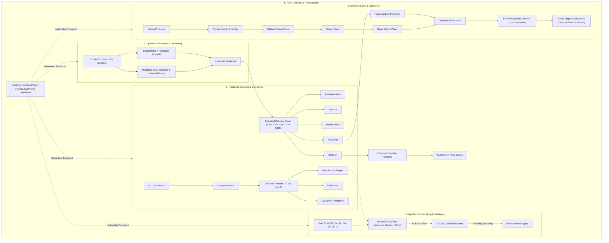

# Mekanism: Complex Industries (Heavy Petrochemical & High-Tech Manufacturing)

[English](README.md) | [简体中文](README_zh.md)

[](LICENSE)
[](https://openjdk.org/)
[](https://www.minecraft.net/)
[](https://neoforged.net/)
[](https://github.com/mekanism/Mekanism)

**Mekanism: Complex Industries (MCI)** is a comprehensive industrial expansion add-on engineered for [Mekanism](https://github.com/mekanism/Mekanism) on Minecraft 1.21.1 (NeoForge). It bridges upstream petroleum resource harvesting, high-temperature thermal cracking, deep cryogenic fractionation, and advanced downstream manufacturing. MCI delivers industrial-scale processing complexes designed with strict adherence to Mekanism's native aesthetics, GUI paradigms, and modular architectural principles.

The mod introduces four major multiblock systems—the **Industrial Refinery Tower** (fractional distillation driven by thermodynamic gradients), the **Industrial Freezer** (sub-100°C cryogenic air separation), the **Fluid Extractor** (high-pressure reservoir extraction), and the **Windmill Pulverizer** (6× ore yield nitrogen-flushed mechanical grinding complex)—alongside an end-to-end **semiconductor fabrication pipeline** and high-throughput **Industrial Logistics Pipes**.

---

## Table of Contents

- [Industrial Topology & Processing Architecture](#industrial-topology--processing-architecture)
- [Core Subsystems Reference](#core-subsystems-reference)
  - [1. Industrial Refinery Tower (Thermal Cracking Column)](#1-industrial-refinery-tower-thermal-cracking-column)
  - [2. Windmill Pulverizer Complex (6× Ore Processing)](#2-windmill-pulverizer-complex-6-ore-processing)
  - [3. Semiconductor Fabrication & Cleanroom Lithography](#3-semiconductor-fabrication--cleanroom-lithography)
  - [4. Industrial Logistics Pipe & Intelligent Interface Network](#4-industrial-logistics-pipe--intelligent-interface-network)
  - [5. Multiblock Fluid Extractor & Powered Pump](#5-multiblock-fluid-extractor--powered-pump)
  - [6. Cryogenic Air Separation & Industrial Freezer](#6-cryogenic-air-separation--industrial-freezer)
  - [7. Chemical Solidification & 4-Tier Factory Scaling](#7-chemical-solidification--4-tier-factory-scaling)
  - [8. Bitumen Infrastructure & Roadway Engineering (51 Blocks)](#8-bitumen-infrastructure--roadway-engineering-51-blocks)
  - [9. Digital Miner Petroleum Harvesting (Mixin Engine)](#9-digital-miner-petroleum-harvesting-mixin-engine)
  - [10. Unified Recipe Viewer Integration (JEI & EMI)](#10-unified-recipe-viewer-integration-jei--emi)
- [Auxiliary Engineering Documentation](#auxiliary-engineering-documentation)
- [Quick Start & Build Guide](#quick-start--build-guide)
- [Repository Structure](#repository-structure)
- [License](#license)

---

## Industrial Topology & Processing Architecture

The integrated processing ecology spans mining, thermodynamic refining, mechanical milling, and ultra-clean electronics manufacturing:



---

## Core Subsystems Reference

### 1. Industrial Refinery Tower (Thermal Cracking Column)
- **Geometry**: 7×7 diamond cross-section (25 blocks per layer), variable height between **16 and 41 blocks**.
- **Thermodynamic Drive**: Requires bottom temperature $T_{\text{bottom}} \ge 500\text{ K}$ and thermal gradient $\Delta T = T_{\text{bottom}} - T_{\text{top}} \ge 100\text{ K}$.
- **Cracking Kinetics**: Effective processing speed scales up to **$640\text{ mB/s}$** ($32\text{ mB/tick}$).
- **Yield Distribution**: Fractionates raw crude into Petroleum Gas (2.0×), Naphtha (0.2×), Refined Fuel (0.1×), Heavy Oil (0.1×), and Bitumen (0.15×).
- **Safety**: Dynamic backpressure interlock halts operation and raises a GUI Warning Tab if any output tank is saturated.

### 2. Windmill Pulverizer Complex (6× Ore Processing)
- **Geometry**: Scalable odd-dimension vault from $5\times 5\times 5$ up to $17\times 18\times 17$.
- **Core Machinery**: Turbine Rotors with mounted Blades, Rotational Complex, Pressure Disperser ring, and Electromagnetic Coils.
- **Processing Power**: 6 independent parallel processing groups consuming 32 raw ores + 1,000 mB Nitrogen per batch.
- **Yield**: Generates **192 Cloudy Oxidized Powders ($6\times$ yield)** directly smeltable into ingots.
- **Speed Multiplier**: Turbine blades and coils dynamically reduce processing time from 600 ticks (30s) down to 100 ticks (5s).

### 3. Semiconductor Fabrication & Cleanroom Lithography
- **Crystal Growth Chamber**: Czochralski crystal pulling mechanism with dedicated in-world 3D BER rendering for silicon boules.
- **Silicon Slicer**: Precision diamond-wire cutting transforming silicon boules into blank wafers.
- **Chemical Film Coater**: Uniform liquid-phase photoresist and polymer deposition.
- **Photolithography Machine**:
  - **Cleanroom Verification**: Validates sealed Filtered Glass enclosures before firing.
  - **Laser Particle Effects**: Custom UV laser animation and cleanroom dust suppression.
  - **Tiered Chip Progression**: Logic & Calculation lines (Infused $\rightarrow$ Reinforced $\rightarrow$ Atomic).

### 4. Industrial Logistics Pipe & Intelligent Interface Network
- **Dynamic 6-Way Rendering**: Industrial Logistics Pipes feature custom directional arms, caps, and animated textures.
- **Modular Interfaces**: Input, Output, and Power Interfaces attachable as standalone blocks or pipe attachments.
- **Control Suite**: Integrated priority routing, item & chemical filtering with network packet sync (`PacketSyncOutputFilter`), and triple-state redstone control.
- **Superconducting Power Interface**: Zero-buffer direct throughput powering attached devices on demand.

### 5. Multiblock Fluid Extractor & Powered Pump
- **Fluid Extractor**: High-pressure multiblock structure with BER animated agitation, designed for massive subterranean fluid reservoir pumping.
- **Powered Pump**: Standalone high-throughput motorized pump or foundation block for multiblock extractors.
- **Liquid Air**: Liquefied ambient air production with native Rotary Condensentrator cycling.

### 6. Cryogenic Air Separation & Industrial Freezer
- **Operating Environment**: Requires temperatures below **$-100.0^\circ\text{C}$ ($173.15\text{ K}$)**.
- **Cryogenic Products**: Separates Compressed Air into high-purity **Nitrogen**, **Noble Gas**, and **Cryogenic Refrigerant**.
- **Resistive Cooler**: Direct electrical cryogenic chiller designed for seamless multiblock thermal coupling.

### 7. Chemical Solidification & 4-Tier Factory Scaling
- **Factory Hierarchy**: Basic (3 slots), Advanced (5 slots), Elite (7 slots), and Ultimate (9 slots).
- **Automation**: Full support for Mekanism upgrades (Speed, Energy, Muffler) and packet-driven automatic inventory sorting.

### 8. Bitumen Infrastructure & Roadway Engineering (51 Blocks)
- **High-Durability Matrix**: 1 raw industrial asphalt + 16 dyed variations.
- **Full Geometry Suite**: Full Blocks, Stairs, and Slabs for every color.
- **Zero-Waste Crafting**: Full compatibility with the Mekanism Painting Machine and Stonecutter.

### 9. Digital Miner Petroleum Harvesting (Mixin Engine)
- **Petroleum Harvesting Upgrade**: Bytecode injected directly into Mekanism's `Upgrade` enum.
- **Filterless Operation**: Automatically detects and harvests liquid crude oil blocks across the operational scan volume.

### 10. Unified Recipe Viewer Integration (JEI & EMI)
- First-class plugins for Just Enough Items (JEI) and EMI NeoForge across all machines:
  - Thermal Cracking & Cryogenic Separation
  - Windmill Pulverizing & Ore Oxidation
  - Crystal Growth, Wafer Slicing & UV Photolithography
  - Chemical Soaking & Film Coating

---

## Auxiliary Engineering Documentation

Comprehensive blueprints, formulas, and developer specifications are maintained in the [`docs/`](docs/) directory:

| Document | Focus Area | Core Content |
| :--- | :--- | :--- |
| [**Advanced Manufacturing Specification**](docs/ADVANCED_MANUFACTURING.md) | High-Tech Systems | Windmill Pulverizer mechanics, semiconductor cleanroom rules, logistics interfaces. |
| [**Refinery Architecture Specification**](docs/REFINERY_ARCHITECTURE.md) | Multiblock Engineering | 7×7 diamond voxel layout, partition calculations, thermodynamic formulas. |
| [**Petrochemical Process Ecology**](docs/PETROCHEMICAL_ECOLOGY.md) | Chemical Engineering | Stoichiometric reaction balances, cryogenic loops, and bitumen road matrices. |
| [**Agent Collaboration SOP**](docs/AGENT_WORKFLOW.md) | Engineering Protocols | AI Agent workflow, reverse-engineering protocols, and headless test loop. |
| [**Developer & Modder Guide**](docs/DEVELOPMENT.md) | Codebase Architecture | Registration systems, Mixin hooks, custom network packets, and GameTests. |

---

## Quick Start & Build Guide

### Prerequisites
- **Java Development Kit (JDK)**: Version 21 (managed via Gradle Toolchain)
- **Minecraft**: 1.21.1
- **NeoForge**: 21.1.200 or newer
- **Mekanism Core**: 1.21.1-10.7.19.85

### Building from Source

```bash
git clone https://github.com/TianYaYou/Mekanism-Complex-Industries.git
cd Mekanism-Complex-Industries
./gradlew build
```

Compiled artifacts are output to `build/libs/`.

### Development & Verification

```bash
# Launch development client
./gradlew runClient

# Run automated headless GameTest suite
./gradlew runGameTestServer

# Hot deploy to local test modpack
./gradlew deployToModpack
```

---

## Repository Structure

```text
Mekanism-Complex-Industries/
├── .github/                              # Issue & PR templates
├── docs/                                 # Architectural specifications & SOPs
│   ├── ADVANCED_MANUFACTURING.md         # Windmill pulverizer, semiconductors, logistics
│   ├── AGENT_WORKFLOW.md                 # Agent development SOP & reverse engineering
│   ├── DEVELOPMENT.md                    # Developer guide & technical taxonomy
│   ├── PETROCHEMICAL_ECOLOGY.md          # Chemical ecology & reaction stoichiometry
│   └── REFINERY_ARCHITECTURE.md          # IRT blueprints & thermodynamic kinetics
├── src/main/java/com/complexindustries/mekanism/
│   ├── MekanismComplexIndustries.java    # Mod entry point
│   ├── client/                           # GUI screens, BER renderers, particles, JEI/EMI
│   ├── content/
│   │   ├── block/                        # Machine blocks, decorative bitumen & filtered glass
│   │   ├── chamber/                      # Crystal Growth Chamber implementation
│   │   ├── coater/                       # Chemical Film Coater implementation
│   │   ├── extractor/                    # Fluid Extractor multiblock & Powered Pump
│   │   ├── fluid/                        # Fluid types (Crude Oil, Liquid Air, Refrigerant)
│   │   ├── freezer/                      # Industrial Freezer multiblock
│   │   ├── lithography/                  # Photolithography Machine implementation
│   │   ├── pipe/                         # Industrial Logistics Pipes, interfaces, network
│   │   ├── pulverizer/                   # Windmill Pulverizer multiblock (6x ore yield)
│   │   ├── refinery/                     # Industrial Refinery Tower multiblock
│   │   ├── slicer/                       # Silicon Slicer implementation
│   │   ├── soaker/                       # Chemical Soaker & 4-tier factories
│   │   ├── solidifier/                   # Chemical Solidifier & 4-tier factories
│   │   └── upgrade/                      # Petroleum Harvesting upgrade mechanics
│   ├── mixin/                            # Mixin hooks for Digital Miner & Boiler
│   ├── network/                          # Custom network packets
│   ├── recipe/                           # Custom recipe serializing, caches, and inputs
│   ├── registration/                     # DeferredRegister registries
│   └── test/                             # GameTest automated verification framework
├── src/main/resources/                   # Blockstates, models, textures, recipes, loot tables
├── build.gradle                          # Build script
├── gradle.properties                     # Version coordinates
└── LICENSE                               # MIT License
```

---

## License

This project is licensed under the **MIT License**. See the [LICENSE](LICENSE) file for details.
