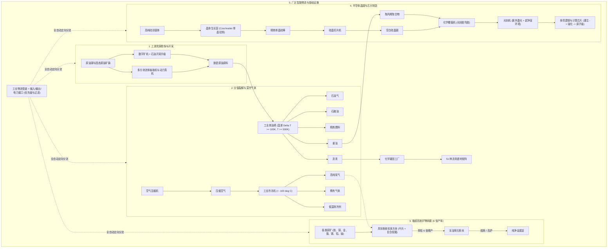

# Mekanism: Complex Industries (重度石化与高新制造生态)

[English](README.md) | [简体中文](README_zh.md)

[](LICENSE)
[](https://openjdk.org/)
[](https://www.minecraft.net/)
[](https://neoforged.net/)
[](https://github.com/mekanism/Mekanism)

**Mekanism: Complex Industries (MCI)** 是专为 Minecraft 1.21.1 (NeoForge) 平台上的 [Mekanism](https://github.com/mekanism/Mekanism) 打造的现代化重工业与高新制造扩展模组。它深度串联起上游原油开采、高温热力学裂解分馏、深冷空气分离、精密半导体制造与高通量厂区物流体系，以原生级的视觉质感与严谨的工业工程逻辑，提供硬核的中后期生产线解决方案。

模组搭载四大核心多方块工业集群：**工业炼油塔**（垂直热力学温差驱动的分馏精馏柱）、**工业冷冻机**（低于 -100°C 的深冷液化分离舱）、**多方块流体抽取机**（深层储层大通量抽取）与**风车粉碎机**（6 倍产率氮气保护机械研磨集群）。在此基础上，MCI 构建了完整的**半导体微电子制造链**与基于智能接口的**工业物流管道网络**。

---

## 目录

- [工业流程拓扑与全局架构](#工业流程拓扑与全局架构)
- [核心子系统详解](#核心子系统详解)
  - [1. 工业炼油塔 (热裂解分馏多方块)](#1-工业炼油塔-热裂解分馏多方块)
  - [2. 风车粉碎机集群 (6 倍矿物增产)](#2-风车粉碎机集群-6-倍矿物增产)
  - [3. 半导体芯片制造与超净室光刻](#3-半导体芯片制造与超净室光刻)
  - [4. 工业物流管道与智能接口网络](#4-工业物流管道与智能接口网络)
  - [5. 多方块流体抽取机与动力泵机](#5-多方块流体抽取机与动力泵机)
  - [6. 深冷空气分离与工业冷冻机](#6-深冷空气分离与工业冷冻机)
  - [7. 化学品固化与 4 级工厂梯队](#7-化学品固化与-4-级工厂梯队)
  - [8. 沥青道路工程与建筑生态 (51 种构件)](#8-沥青道路工程与建筑生态-51-种构件)
  - [9. 数字矿机石油开采升级 (Mixin 引擎)](#9-数字矿机石油开采升级-mixin-引擎)
  - [10. 全配方查看器深度集成 (JEI 与 EMI)](#10-全配方查看器深度集成-jei-与-emi)
- [扩展工程与技术文档](#扩展工程与技术文档)
- [快速上手与构建指南](#快速上手与构建指南)
- [仓库目录结构](#仓库目录结构)
- [开源协议](#开源协议)

---

## 工业流程拓扑与全局架构

全生态涵盖采矿提纯、热力学分馏、机械深加工与精密微电子制程：



---

## 核心子系统详解

### 1. 工业炼油塔 (热裂解分馏多方块)
- **结构几何**：7×7 菱形截面（每层 25 个有效方块），高度可在 **16 至 41 方块** 之间扩展。
- **热力学驱动**：依赖底部加热（$T_{\text{bottom}} \ge 500\text{ K}$）与垂直温度梯度（$\Delta T \ge 100\text{ K}$），有效裂解速率最高达到 **$640\text{ mB/s}$**。
- **馏分切分**：将原油自动分馏为石油气（2.0×）、石脑油（0.2×）、精炼燃料（0.1×）、重油（0.1×）与沥青（0.15×）。
- **动态安全联锁**：当任意产物储罐满载时，自动触发背压保护并点亮 Mekanism 原生 WarningTab 警告。

### 2. 风车粉碎机集群 (6 倍矿物增产)
- **结构几何**：水平尺寸必须为奇数的巨型密闭腔体（$5\times 5\times 5$ 至 $17\times 18\times 17$）。
- **内部机械装配**：中央轴立式涡轮转子、装配涡轮叶片、复合旋钮装置、周边压力分散层与顶部电磁线圈。
- **处理能力**：6 组独立并行处理通道，单批次投入 32 块原矿与 1,000 mB 氮气介质。
- **极致增产**：产出 **192 份浑浊氧化粉末（稳定 6 倍产率）**，可直接进炉熔炼为成品金属锭。
- **转速动力学**：叶片与线圈数量动态联动，将处理耗时从 600 ticks（30秒）缩减至最低 100 ticks（5秒）。

### 3. 半导体芯片制造与超净室光刻
- **晶体生长室（Crystal Growth Chamber）**：高真空 Czochralski 直拉单晶硅技术，带有世界内籽晶与硅棒生长的实时 3D 渲染（BER）。
- **硅晶切片机（Silicon Slicer）**：金刚石线锯将精炼硅棒精密切割为晶圆空白基底（Blank Wafer）。
- **化学覆膜机（Chemical Film Coater）**：基于聚丙烯与光刻胶在晶圆表面均匀涂覆高分子保护膜。
- **光刻机（Photolithography Machine）**：
  - **超净室环境校验**：检测机台是否被滤光玻璃（Filtered Glass）严密包裹，杜绝粉尘污染。
  - **高能激光粒子**：具备紫外激光束与净化室粉尘动态粒子渲染。
  - **芯片进阶树**：支持逻辑芯片与计算芯片从灌注级（Infused）$\to$ 强化级（Reinforced）$\to$ 原子级（Atomic）的阶梯制造。

### 4. 工业物流管道与智能接口网络
- **六向动态装配**：工业管道具有专有的动态连接臂、封堵帽与流动动画材质。
- **多功能智能接口**：提供输入接口、输出接口与电力接口（支持方块与挂接部件双形态）。
- **精细化控制流**：支持高低整数优先级路由、网络数据包双向同步高级过滤器（`PacketSyncOutputFilter`）及三态红石联锁。
- **超导电力接口**：零内阻直通模式，按需抽取并供给网络内用电机器。

### 5. 多方块流体抽取机与动力泵机
- **流体抽取机**：带动态流体液面与搅拌动画的大型多方块开采装置，用于地下深层油层与地下水脉的持续抽取。
- **动力泵机**：高吞吐量单方块管道增压机，亦可直接作为流体抽取机底面的动力基座。
- **液态空气**：提供常温常压空气的低温深冷液化形态及相关循环反应。

### 6. 深冷空气分离与工业冷冻机
- **深冷工况**：腔室温度必须冷却至 **$-100.0^\circ\text{C}$ ($173.15\text{ K}$)** 以下。
- **分馏产物**：压缩空气深度分离为高纯**氮气**、**稀有气体**与**低温制冷剂**。
- **电阻冷却器**：将电能直接转化为深冷负温热流，无缝对接冷冻机维持低温。

### 7. 化学品固化与 4 级工厂梯队
- **工厂升级树**：支持基础（3 通道）、高级（5 通道）、精英（7 通道）与终极（9 通道）工厂。
- **插件扩展**：全面支持速度、能量、消音升级，集成网络化产物自动整理。

### 8. 沥青道路工程与建筑生态 (51 种构件)
- **完整色谱矩阵**：1 种原始防滑沥青 + 16 种经典染色工业沥青。
- **造型全覆盖**：每种颜色均包含完整方块、楼梯与台阶。
- **工业无损换色**：全面支持在 Mekanism 涂装机中染色与切石机快速裁切。

### 9. 数字矿机石油开采升级 (Mixin 引擎)
- **字节码运行时注入**：通过 Mixin 动态挂载到 Mekanism 原生 `Upgrade` 枚举体系。
- **免过滤智能采油**：插入数字矿机后自动全量采掘作业范围内的所有原油液体源块。

### 10. 全配方查看器深度集成 (JEI 与 EMI)
- 全模组机器原生接入 JEI 与 EMI NeoForge 插件：
  - 炼油热裂解与低温空气蒸馏
  - 风车粉碎机氮气研磨与 6 倍增产
  - 单晶生长、晶圆切片与超净室紫外光刻
  - 化学浸泡反应与化学覆膜

---

## 扩展工程与技术文档

详细的机械结构、体素布局与数学模型收录于 [`docs/`](docs/) 目录：

| 文档名称 | 核心领域 | 主要内容 |
| :--- | :--- | :--- |
| [**高新制造与矿物处理规约**](docs/ADVANCED_MANUFACTURING.md) | 高新制造核心 | 风车粉碎机结构动力学、超净室光刻标准、智能物流接口原理。 |
| [**工业炼油塔架构蓝图**](docs/REFINERY_ARCHITECTURE.md) | 多方块工程 | 7×7 菱形体素截面图、分馏隔板计算公式、热力学动力学方程。 |
| [**石化与深冷工艺生态指南**](docs/PETROCHEMICAL_ECOLOGY.md) | 化工流程 | 反应物计量比、世界生成参数、深冷循环平衡与沥青建材配方。 |
| [**Agent 协作研发规范 (SOP)**](docs/AGENT_WORKFLOW.md) | 工程质量与流程 | AI Agent 自动化逆向工程、无头验证协议与闭环提交规范。 |
| [**模组开发与架构参考**](docs/DEVELOPMENT.md) | 二次开发手册 | 开发环境搭建、DeferredRegister 注册表总览与 Mixin 拦截分析。 |

---

## 快速上手与构建指南

### 环境依赖
- **Java 开发环境 (JDK)**：Java 21（由 Gradle Toolchain 自动管理）
- **Minecraft 版本**：1.21.1
- **NeoForge 版本**：21.1.200 或更高
- **Mekanism 原置**：1.21.1-10.7.19.85

### 从源码编译

```bash
git clone https://github.com/TianYaYou/Mekanism-Complex-Industries.git
cd Mekanism-Complex-Industries
./gradlew build
```

编译生成的 Jar 包位于 `build/libs/` 目录下。

### 本地调试与测试

```bash
# 启动开发调试客户端
./gradlew runClient

# 运行自动化无头 GameTest 回归测试套件
./gradlew runGameTestServer

# 一键热部署至本地测试整合包
./gradlew deployToModpack
```

---

## 仓库目录结构

```text
Mekanism-Complex-Industries/
├── .github/                              # 缺陷报告与功能建议 Issue/PR 模板
├── docs/                                 # 架构技术规范与工程白皮书
│   ├── ADVANCED_MANUFACTURING.md         # 风车粉碎机、半导体微电子、智能管道物流
│   ├── AGENT_WORKFLOW.md                 # Agent 工程研发工作流与逆向规范 (SOP)
│   ├── DEVELOPMENT.md                    # 模组开发者手册与架构总表
│   ├── PETROCHEMICAL_ECOLOGY.md          # 化工生态、反应计量比与工厂能耗梯级
│   └── REFINERY_ARCHITECTURE.md          # 炼油塔蓝图、隔板计算与热力学方程
├── src/main/java/com/complexindustries/mekanism/
│   ├── MekanismComplexIndustries.java    # 模组生命周期主入口
│   ├── client/                           # GUI 屏幕、BER 动态渲染器、粒子系统、JEI/EMI 插件
│   ├── content/
│   │   ├── block/                        # 机器方块定义、滤光玻璃与 51 种沥青建材
│   │   ├── chamber/                      # 晶体生长室方块实体与容器实现
│   │   ├── coater/                       # 化学覆膜机方块实体与容器实现
│   │   ├── extractor/                    # 流体抽取机多方块结构与动力泵机
│   │   ├── fluid/                        # 流体类型（原油、液态空气、低温制冷剂）
│   │   ├── freezer/                      # 工业冷冻机多方块结构
│   │   ├── lithography/                  # 光刻机与超净室检测机制
│   │   ├── pipe/                         # 工业物流管道、智能接口网络与过滤器
│   │   ├── pulverizer/                   # 风车粉碎机多方块结构（6 倍矿物增产）
│   │   ├── refinery/                     # 工业炼油塔多方块结构
│   │   ├── slicer/                       # 硅晶切片机实现
│   │   ├── soaker/                       # 化学浸泡机与 4 级浸泡工厂
│   │   ├── solidifier/                   # 化学凝固机与 4 级凝固工厂
│   │   └── upgrade/                      # 石油开采升级物品与 Mixin 注入器
│   ├── mixin/                            # 针对 Mekanism 核心的 Mixin 拦截
│   ├── network/                          # 客户端-服务端自定义数据包通信协议
│   ├── recipe/                           # 自定义配方序列化器、输入缓存与执行逻辑
│   ├── registration/                     # DeferredRegister 延迟注册系统
│   └── test/                             # GameTest 自动化无头回归测试套件
├── src/main/resources/                   # 方块状态、模型、纹理贴图、合成配方与战利品表
├── build.gradle                          # 构建脚本
├── gradle.properties                     # 版本配置
└── LICENSE                               # MIT 开源许可证
```

---

## 开源协议

本项目采用 **MIT 开源许可证**。详情参见 [LICENSE](LICENSE) 文件。
