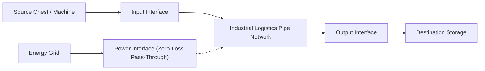

# Advanced Manufacturing & Ore Processing Specification

> Engineering, mechanics, and process guidelines for **Semiconductor Photolithography, Logistics Pipes, Multiblock Extraction, and Windmill Pulverization** in **Mekanism: Complex Industries (MCI)**.

---

## Table of Contents
1. [Windmill Pulverizer Multiblock (6x Ore Yield)](#1-windmill-pulverizer-multiblock-6x-ore-yield)
2. [Semiconductor & Chip Manufacturing Chain](#2-semiconductor--chip-manufacturing-chain)
3. [Industrial Logistics Pipe & Interface Network](#3-industrial-logistics-pipe--interface-network)
4. [Multiblock Fluid Extractor & Powered Pump](#4-multiblock-fluid-extractor--powered-pump)
5. [Chemical Soaking & Polypropylene Polymerization](#5-chemical-soaking--polypropylene-polymerization)

---

## 1. Windmill Pulverizer Multiblock (6x Ore Yield)

The **Windmill Pulverizer** is an ultra-high-efficiency mechanical crushing complex adapted from Mekanism Generators' industrial turbine mechanics:

### Structural Dimensions & Constraints
- **Footprint**: Odd dimensions from $5 \times 5$ up to $17 \times 17$ (Odd horizontal dimensions required).
- **Height**: $5$ to $18$ blocks.
- **External Frame**: Reinforced Pressure Casing (`fluid_extractor_casing`) with Structural Glass.
- **Ports**: At least 1 Windmill Injector (`windmill_injector`) and 1 Windmill Output Port (`windmill_output_port`).
- **Internal Core Assembly**:
  1. Base to Rotor: Vertical column of Turbine Rotors equipped with Turbine Blades.
  2. Rotational Complex: Mounted directly on top of the uppermost rotor.
  3. Pressure Disperser Ring: Horizontal layer surrounding the Rotational Complex.
  4. Electromagnetic Coils: Positioned directly above the Rotational Complex.
  5. Cavity Constraints: Lower rotor chamber and upper coil chamber must remain hollow (air).

### Crushing Kinetics & Multiplier
- **Parallel Processing**: 6 independent batch channels.
- **Batch Size**: 32 Raw Ores + 1,000 mB Nitrogen gas input.
- **Yield Multiplier**: $6\times$ yield producing **192 Cloudy Oxidized Powders** per batch.
- **Speed Multiplier**:
  $$\text{Multiplier} = 1.0 + (\text{Blades} \times 0.05) + (\text{Coils} \times 0.10)$$
- **Base Duration**: 600 ticks (30s), scalable down to 100 ticks (5s) at peak rotor efficiency.
- **Smelting/Blasting**: Cloudy Oxidized Powders smelt directly into standard metal ingots.

---

## 2. Semiconductor & Chip Manufacturing Chain

MCI implements an end-to-end semiconductor fabrication pipeline:

```mermaid
flowchart TD
    Sand["Sand / Quartz"] -->|Chemical Injection| CrudeSi["Crude Silicon"]
    CrudeSi -->|Crystal Growth Chamber| RefinedSi["Refined Silicon Boule"]
    RefinedSi -->|Silicon Slicer| Wafer["Blank Silicon Wafer"]

    Wafer -->|Chemical Film Coater (Polypropylene)| CoatedWafer["Coated Photoresist Wafer"]
    CoatedWafer -->|Photolithography Machine (Mask + UV)| SemiChip["Semifinished Logic / Calculation Chip"]

    SemiChip -->|Chemical Infusion / Coating| InfusedChip["Infused Chip"]
    InfusedChip -->|Tiered Photolithography| ReinfChip["Reinforced Chip"]
    ReinfChip -->|Atomic Deposition| AtomicChip["Atomic Calculation / Logic Chip"]
```

### Machine Specifications
- **Crystal Growth Chamber**: High-temperature Czochralski growth mechanism with custom BER 3D rendering for growing boules.
- **Silicon Slicer**: Precision diamond-wire slicing of refined ingots into micro-wafers.
- **Chemical Film Coater**: Uniform liquid polymer and photoresist deposition.
- **Photolithography Machine**:
  - **Cleanroom Protocol**: Actively verifies sealed filtered-glass enclosures.
  - **Optics & Lasers**: High-intensity UV laser beam particle rendering.
  - **Interchangeable Masks**: Logic Mask & Calculation Mask dictate circuit lithography.

---

## 3. Industrial Logistics Pipe & Interface Network

A high-performance modular routing system designed to bypass traditional entity-drop and tick bottlenecks:



- **Industrial Logistics Pipe**: Seamless 6-way dynamic visual arm and cap rendering with animated textures.
- **Input / Output Interfaces**:
  - Modular Attachment Parts convert pipes into direct inventory access points.
  - Priority Management: Configurable integer priority levels (High to Low).
  - Advanced Filtering: Item and chemical filter matrices with client-server network packet synchronization (`PacketSyncOutputFilter`).
  - Redstone Controls: Ignored, Normal, or Inverted redstone interlocks.
- **Power Interface**: Lossless zero-buffer superconducting pass-through mode powering downstream machines on demand.

---

## 4. Multiblock Fluid Extractor & Powered Pump

Engineered for mass extraction of liquid resources and pressurized transport:

### Fluid Extractor Multiblock
- **Components**: Fluid Extractor Casing (Pressure Casing), Extraction Ports, and Powered Pumps.
- **Floor Requirement**: Sealed bottom composed exclusively of Powered Pumps or Structural Glass.
- **Dynamic Render**: Dedicated BER rendering fluid levels, operational vortexes, and agitation animations.
- **Extraction Targets**: Deep underground reservoirs, sub-bedrock aquifers, and viscous crude oil tables.

### Powered Pump
- **Function**: Autonomous single-block high-throughput pump.
- **Integration**: Operates standalone or acts as the functional floor motor of the Multiblock Fluid Extractor.

---

## 5. Chemical Soaking & Polypropylene Polymerization

- **Chemical Soaker & 4-Tier Factories**: Basic, Advanced, Elite, and Ultimate tiers processing solid-gas and solid-fluid immersion reactions.
- **Polypropylene Materials**: Heavy Oil cracking yields Liquid Propylene, converted via pressurized reaction chambers (PRC) into pellets and durable industrial sheets.
